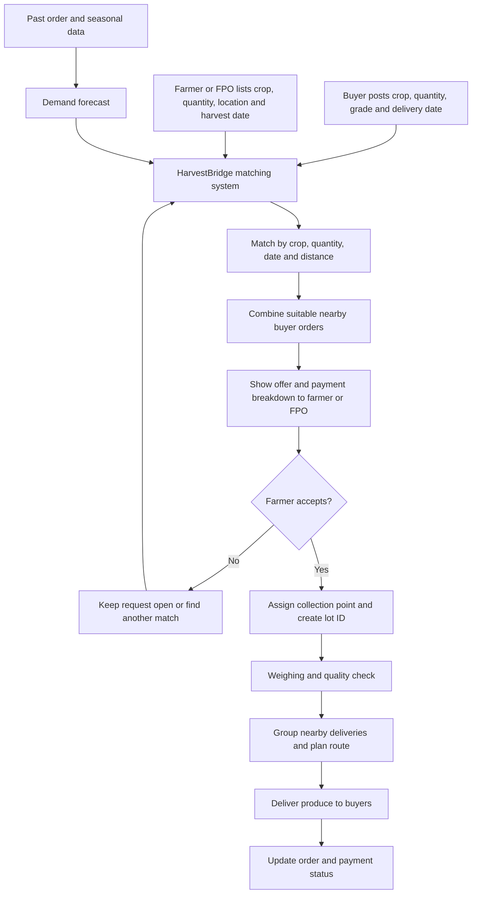

# Smart India Hackathon Workshop

**Date:** 24 November 2026  
**Reference Number:** [Enter your assigned reference number]  
**Name:** JANESH M

## Problem Title

**SIH 26033: Multiple intermediaries reduce farmers' earnings and increase consumer prices.**

## Problem Creator's Organization

Ministry of Consumer Affairs, Food & Public Distribution

## Theme

Agriculture, FoodTech & Rural Development

## Problem Description

In many cases, farm produce passes through several people or businesses before it reaches the final buyer. Each step can add handling, storage, commission or transport costs. Farmers may not know where the best demand is, while consumers and bulk buyers may pay more than necessary.

The aim of this project is to make the connection between farmers and buyers more direct and to make the movement of produce better organised. The platform should also help farmers understand demand, instead of depending only on last-minute sales after harvesting.

## Proposed Solution

### HarvestBridge – A Demand-First Farm Marketplace

HarvestBridge is a proposed web-based marketplace that connects farmers and Farmer Producer Organisations (FPOs) with households, shops, hotels, supermarkets and other bulk buyers.

The main idea is simple: **collect buyer requirements first, combine nearby orders, and then match that demand with farmers who can supply the produce.** Most basic marketplace ideas start with a seller uploading products and waiting for someone to buy them. HarvestBridge also allows buyers to post what they need and when they need it. This gives farmers and FPOs a clearer picture of demand before they prepare a lot for sale.

### How it would work

1. **Buyers post their requirements.** A buyer selects the crop, quantity, quality or grade, delivery area and required date. For example, a hostel may request a regular quantity of tomatoes and onions for the coming week.
2. **Farmers list available or upcoming produce.** A farmer or FPO adds the crop, estimated quantity, expected harvest date, location and basic quality details. The quantity can be updated if the harvest changes.
3. **Nearby demand is combined.** HarvestBridge looks for requests for the same crop with compatible dates and locations. Smaller buyer requests can be grouped into one larger order where it makes sense. This can help farmers who do not have enough produce to attract a large buyer on their own.
4. **Farmers receive a match suggestion.** The platform shows suitable buyer demand, the expected quantity, the collection point and an estimated payment breakdown. The farmer or FPO can accept or reject the offer; the system does not make the decision on the farmer's behalf.
5. **Produce is collected and checked.** Accepted orders are assigned to an existing FPO centre or another agreed local collection point. The produce is weighed and its quality is checked before dispatch. Each lot receives a simple tracking number so that the buyer can follow the order.
6. **Deliveries are grouped.** Orders going to nearby locations are planned together where possible. This can reduce the number of partly filled trips and avoid sending separate vehicles for small orders.
7. **Payment details are visible.** The order summary shows the agreed produce value, transport charge and any platform charge separately. This helps both sides understand how the final amount was calculated.

### Main features

- **Demand Board:** Buyers can post future requirements instead of only searching through products already listed.
- **Harvest Window Matching:** Farmers can list produce that will be ready on a particular date, allowing buyers and sellers to plan ahead.
- **Order Pooling:** Several small orders for the same crop and nearby delivery areas can be combined into a practical bulk order.
- **Fair Price Breakdown:** Farmers can see the selling amount and deductions separately before accepting an order.
- **Shared Collection Points:** FPO centres or agreed local collection points can be used for weighing, checking and grouping produce.
- **Smart Delivery Planning:** The system can group nearby deliveries and suggest a shorter route for the assigned vehicle.
- **Demand Forecast:** Past orders and seasonal buying patterns can be used to estimate which crops may have higher demand in a particular area.

### What makes HarvestBridge different?

The main difference is its **demand-first approach**. It does not depend only on farmers uploading whatever they have after harvesting. Buyers can first tell the platform what they need, and the platform can combine similar requirements. Farmers then get a chance to decide whether the available demand is suitable for them.

The second part is connecting order pooling with transport planning. Combining orders is useful only when the produce can also be collected and delivered sensibly. HarvestBridge therefore treats matching, collection and delivery as parts of the same process.

The platform is not intended to remove every trader or replace existing agricultural markets. It is meant to give farmers and FPOs another selling option, reduce avoidable steps where direct trade is possible, and make costs easier to understand.

## Technical Approach

### Technologies to be used

The project can be developed as a responsive website first, so that it works on both computers and mobile phones.

- **Frontend:** HTML, CSS and JavaScript. React can be used to organise the pages and reusable components.
- **Backend:** Node.js with Express.js to handle user accounts, crop listings, buyer requests, orders and delivery records.
- **Database:** MongoDB to store users, crop details, demand requests, matched orders, collection records and payment summaries.
- **Demand analysis:** Python with Pandas and Scikit-learn can be used to study previous order records and create a basic demand forecast. The first version can use simple averages and seasonal patterns; a more advanced model would need enough reliable data.
- **Maps and routes:** OpenStreetMap can provide map data. A routing service such as OSRM can be tested to suggest routes between collection points and buyers.
- **Notifications:** In-app updates can show when a request is matched, accepted, collected or delivered. SMS or WhatsApp notifications can be considered in a later version.

### System workflow

The following diagram shows the proposed flow from buyer demand to delivery.

### Main modules

1. **User module:** Separate registration and login for farmers/FPOs, buyers and administrators.
2. **Crop listing module:** Add, edit and update crop availability, expected quantity, harvest date and location.
3. **Buyer demand module:** Create, view and update purchase requirements.
4. **Matching and pooling module:** Find compatible supply and demand using crop, quantity, date and distance. Orders should only be combined when their quality and delivery requirements are compatible.
5. **Collection and tracking module:** Record the collection point, lot number, quantity checked and order status.
6. **Logistics module:** Group deliveries by nearby destinations and suggest a route. A coordinator can review the suggestion before assigning a vehicle.
7. **Forecast and reports module:** Display estimated demand and basic reports such as orders completed, unsold quantity and delivery cost.

### Implementation plan

The first version should focus on the features that can be tested with sample data:

- Create farmer, FPO and buyer accounts.
- Allow farmers to list crops and buyers to post requirements.
- Match requests using crop, quantity, location and date.
- Display pooled orders and a clear price breakdown.
- Allow an administrator to assign a collection point and update delivery status.

After the basic workflow works, route suggestions and demand forecasting can be added. This order of development keeps the project manageable and makes it possible to test the core idea before adding more advanced features.

## Feasibility and Viability

### Why the idea is practical

HarvestBridge can begin with a small pilot involving one FPO or farmer group, a few local buyers and a limited number of commonly traded crops. It does not need warehouses, vehicles or collection centres to be owned by the project team. It can make use of existing FPO facilities and local transport providers wherever available.

The first version also does not depend on a complicated AI model. Matching can initially be done using clear rules such as crop, quantity, date and distance. Demand forecasting can start with past order totals and seasonal patterns. More advanced prediction should only be introduced after enough useful data has been collected.

### Possible challenges and how to handle them

- **Farmers may not be comfortable using a website:** Keep the listing form short, make it mobile-friendly and allow an FPO representative to help farmers add or update listings. Tamil and other local-language support can be added.
- **Harvest quantity may change:** Treat listed quantities as estimates until the farmer confirms the final quantity. Allow updates before the order is confirmed.
- **Quality disagreements may happen:** Use clear grade descriptions, weighing records and a check at the collection point. Keep a record of any difference reported by the buyer.
- **Transport may not be available at the right time:** Start by working with existing local transport providers. The platform can suggest grouped deliveries, while a coordinator confirms the actual vehicle and schedule.
- **Forecasts may be inaccurate at first:** Show forecasts as estimates, not guarantees. Start with simple calculations and improve them as completed order data grows.
- **Farmers and buyers may worry about payment:** Show the agreed amount and every deduction before confirmation. For a prototype, payment status can be recorded manually; a verified payment gateway can be considered for a deployed version.

### Long-term sustainability

The platform could be maintained through a small, clearly displayed service fee on completed orders or through a service arrangement with FPOs and bulk buyers. Any fee should be shown before an order is accepted. The project should avoid adding hidden charges that reduce the benefit to farmers.

## Impact and Benefits

### Benefits for farmers and FPOs

- Access to demand from several types of buyers, not only one local purchaser.
- Better visibility of future demand before the produce is ready.
- A chance to combine smaller quantities with nearby farmers through an FPO or collection point.
- Clear information about the selling amount and deductions.
- More organised collection and fewer unnecessary trips where orders can be grouped.

### Benefits for consumers and bulk buyers

- A simpler way to find nearby farmers and FPOs.
- More visibility into crop availability, quantity, grade and expected delivery date.
- The possibility of lower avoidable handling and transport costs.
- Better planning for regular buyers such as hostels, hotels, shops and canteens.

### Benefits to the supply chain

- Better coordination between supply, demand and transportation.
- Less chance of produce remaining unsold because demand was not identified in time.
- Better use of vehicle space when nearby orders are grouped.
- More information about where delays, quality issues or extra costs occur.

The impact should be measured during a pilot instead of assuming that the platform will automatically reduce prices. Useful measurements include the amount received by farmers, the final price paid by buyers, delivery cost per kilogram, vehicle load utilisation, order completion time and the quantity left unsold.

## Research and References

The following sources were reviewed to understand existing agricultural market systems and the role of farmer collectives. HarvestBridge is proposed as an additional tool that can work alongside existing systems, not as a replacement for them.

1. **e-NAM – Farmer Producer Organisations (FPOs):** Explains how FPOs aggregate produce from member farmers and can trade as a group. This supports the idea of using FPOs as collection and coordination partners.  
   https://www.enam.gov.in/web/stakeholders-Involved/fpos

2. **Small Farmers' Agribusiness Consortium (SFAC) – State Level Consortium of FPOs:** Describes how producer organisations can improve coordination and access to markets, technology and services.  
   https://sfacindia.com/State-Level-Producer-Companies.aspx

3. **AGMARKNET information – National Portal of India:** Describes the availability of agricultural market information, commodity arrivals and prices. Such information could be useful as one reference for a future price-information feature.  
   https://www.india.gov.in/category/agriculture-rural-environment/subcategory/agricultural-produce/details/website-of-agmarknet

4. **Press Information Bureau – National Agriculture Market (e-NAM), 13 April 2026:** Provides an overview of e-NAM's digital agricultural trading system and its market-linkage features.  
   https://www.pib.gov.in/PressNoteDetails.aspx?ModuleId=3&NoteId=158169&id=158169&lang=1&reg=3

---

**Project note:** HarvestBridge is a proposed solution for the SIH 26033 problem statement. The features and benefits described above are planned capabilities, not claims that a working platform has already been deployed. A pilot with local farmers/FPOs and buyers would be needed to test the idea and measure its actual results.
